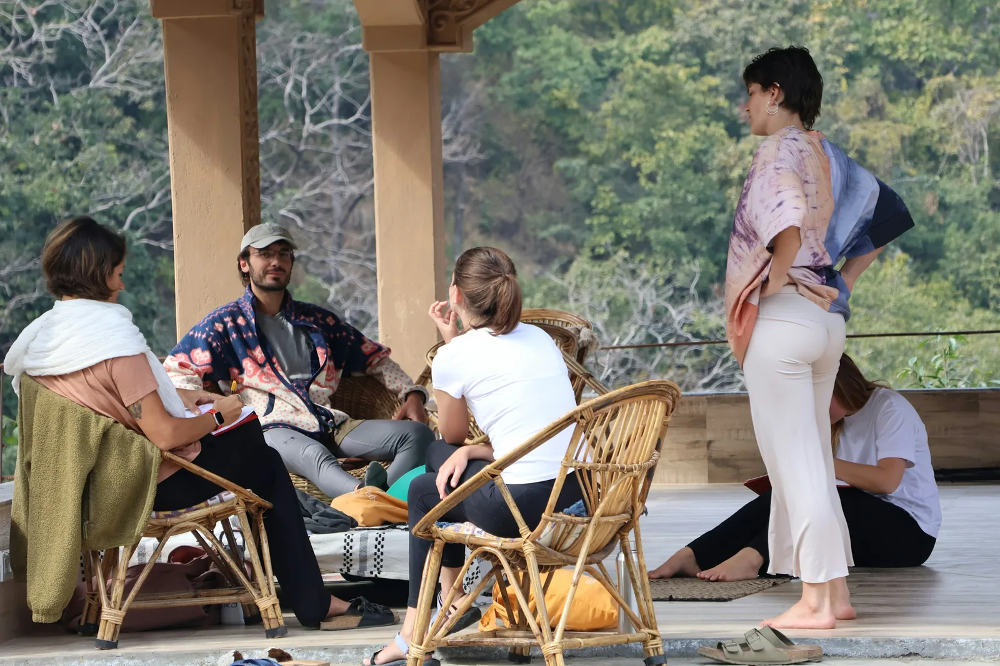
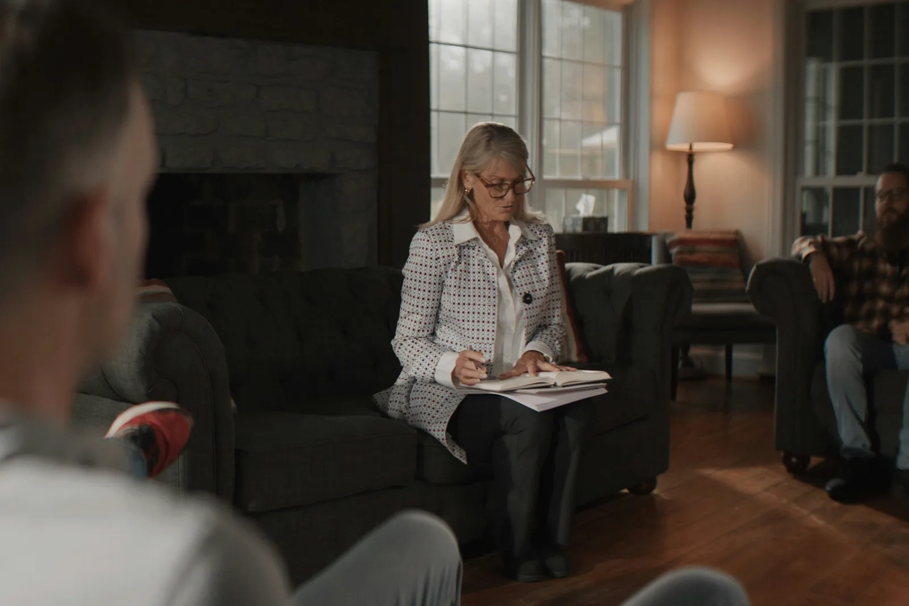
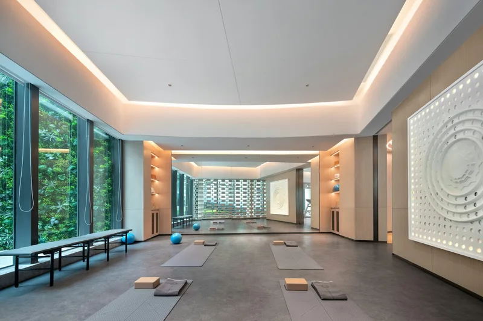
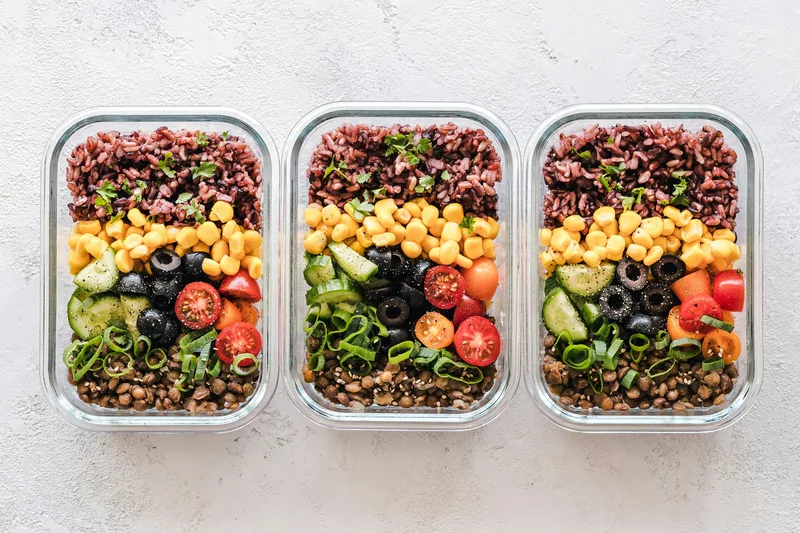
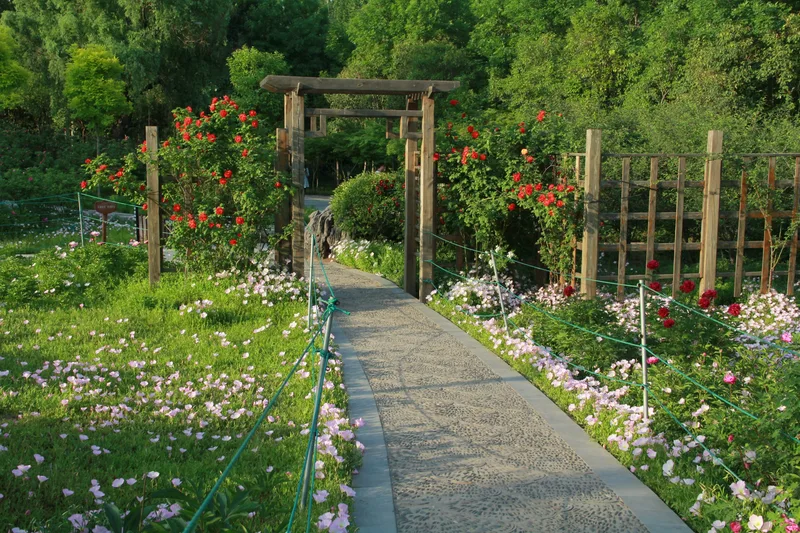

# Harborlight component guide (for page builders)

Brand: **Harborlight Recovery Centre** (fictional de-addiction and rehabilitation centre). Mood: "a harbour light at dawn": calm, safe, hopeful, private.
Tone: non-judgemental, person-first ("person in recovery", "person who uses alcohol", never "addict"/"alcoholic"/"abuser"), plain language, evidence-based
(CBT, DBT, MAT, mindfulness, family therapy, relapse prevention; 12-step and SMART Recovery are *optional*). No stigmatising images or words.
Currency INR (`₹1,45,000`, en-IN grouping; `Harborlight.fmtPrice(n)`). Dashboard: **No** (no login, sign-up or dashboard anywhere).

Facts (use exactly these everywhere):
- Campus: 18 Lighthouse Lane, Kovalam Road, Muttukadu, Chennai 603112 (30 bed residential campus near the sea, 4 acres of gardens). City counselling office: 42 Greenways Road, R. A. Puram, Chennai 600028 (outpatient + aftercare).
- **24/7 confidential helpline: 1800 270 4455** (toll-free, `tel:18002704455`). Admissions/main: +91 44 2747 0200. Email care@harborlight.example. Emergency 112, Tele-MANAS 14416.
- Admissions office Mon to Sat 8:00 to 20:00; helpline and nursing 24/7. Visiting Sundays 10:00 to 16:00 (from week 2 of a residential stay). Founded 2012. Adults 18+.
- Team (photos ONLY on about.html, arched portraits): team-1 **Dr Arvind Raghavan** (Medical Director, Consultant Psychiatrist), team-2 **Dr Meera Iyer** (Clinical Psychologist),
  team-3 **Joel D'Souza** (Senior Addiction Counsellor), team-4 **Sister Anjali Thomas** (Nurse Manager), team-5 **Kavya Menon** (Yoga and Wellness Lead), team-6 **Rahul Desai** (Family Therapist).
  Founder founder-1 **Dr Leela Krishnan** (psychiatrist, founded Harborlight in 2012).
- Testimonials (first name + initial for privacy): testi-1 **Ananya R.** (residential program, 2024), testi-2 **Vikram M.** (outpatient day program), testi-3 **Kamala V.** (mother of a person in recovery)
  -> Home 1; testi-4 **Arjun P.** (digital addiction program), testi-5 **Sofia D.** (aftercare alumna), testi-6 **George T.** (alcohol recovery, three years on) -> Home 2.
- Blog authors (author-N on blog.html + blog-post-N.html only): 1 Dr Nisha Kapoor, 2 Karan Mehta, 3 Dr Ama Owusu, 4 Daniel Brooks, 5 Dr Shreya Nair, 6 Tom Varghese, 7 Grace Mwangi (pick roles to fit the article).
- Programs: `data/programs.json` (8: core residential, outpatient, detox, aftercare with detail pages; specialist family, dual, digital, alcohol). JS: `window.Harborlight.programs`.
- Photos: `images/ASSIGNMENT.md` (each photo on ONE page; blog-N/author-N pair is the only exception).

## Visual identity (this site must NOT look like Tidewell/Drivora; do not bring back their patterns)
- **Fonts:** headings **Manrope** (h1/h2 700-800, letter-spacing -0.02 to -0.035em; h3 650), body **Mulish** (line-height 1.7). Tokens `--f-head` / `--f-body`. No serif, no italics for display.
- **Palette:** pine `--primary #24584A` (the ONE CTA colour; text-safe `--primary-ink #1B4438`), sage `--tint #EEF3EF`, sage block `--tint-2`, linen page `--bg #FAF7F2`,
  warm `--sand`, charcoal `--ink #1F2A2A`, `--muted`. Dawn amber `--accent #E3A54A` is **decorative only** (dots, rules, horizon sun, underline); amber TEXT uses `--accent-ink`.
  Dark theme (deep pine night `#0F1D19`) is automatic through tokens. Never hard-code colours in page CSS.
- **Shapes:** pill buttons (`--r-pill`), 28px photo frames (`--r-xl`), arched (rounded-top) photo masks (`--arch`, portraits `--arch-portrait`), thin 1.5px outline circles.
- **Signature pieces:** transparent header over the hero that turns solid linen + blur on scroll; pine helpline bar at the very top (not sticky); dawn gradient heroes with one
  amber-highlighted word; sunrise strip; story bands with an offset sage block; horizon dividers with a rising amber sun; borderless soft-shadow cards; program list rows;
  milestones in outline circles; ONE centred quote carousel; minimal line FAQ with + turning into x; dark pine footer with a closing statement.
- **Avoid:** bordered card grids everywhere, wave dividers, pebble/blob shapes, 3 testimonial cards in a row, coloured header bars, heavy hero overlays.
- **Motion:** slow fade-ups on scroll, gentle hero photo settle, count-up numbers, smooth FAQ, carousel cross-fade. Automatic; off for reduced motion and automation. Never add `data-reveal` yourself.

## Rules
- Write ONLY `src/pages/<yourpage>.html`, `css/pages/<page>.css`, `js/pages/<page>.js`. Never edit `css/site.css`, `js/site.js`, `js/validation.js`, `src/partials/*`,
  `scripts/build.py`, `data/programs.json`, `src/templates/*` (foundation owns them; report needed shared changes).
- After every edit run `python3 scripts/build.py` from `site/` (rebuilds every page; it also lists image files that do not exist). Never edit generated root `*.html`.
- Every ``: real `alt`, `width`/`height`, `loading="lazy" decoding="async"` below the fold. Photos cover their frame; add `object-position` in page CSS if a face is near an edge.
- Logical properties only (`margin-inline`, `inset-inline-start`, `text-align: start`). Arrow icons get `class="flip"`. Phone numbers inside `<span class="ltr-num">`.
- ONE primary CTA style: `btn btn-primary` (pine, filled pill). Max 2 CTAs per hero. Two adjacent buttons never go to the same page.
- Section headings: `.intro` (eyebrow, h2, paragraph directly under). Inner heroes come from front matter; keep `h1` <= 40 characters and `lead` <= 120 characters.
- Card rows must stay level (subgrid). Re-check 1440, 1024, 768 and 360px. No horizontal scroll.
- QA: `node tests/qa.cjs . --pages yourpage.html --quick` while iterating, then without `--quick`. Fix everything it reports for your page.

---

## Build system (`scripts/build.py`)

`src/pages/<name>.html` -> `<name>.html`. Optional front matter (first line `---`, `key: value` lines, closing `---`). Single layout: public page.

| Key | Meaning |
|---|---|
| `title`, `description` | `<title>` and meta description |
| `nav` | current nav item: `home1 home2 about programs facilities blog contact` (or empty) |
| `hero` | slot (e.g. `hero-about`): build inserts the standard inner hero (`.page-hero` + dawn overlay + horizon line, same height on every page) with `hero_alt`, `crumbs` (`About` or `Programs=programs.html\|Detox`), `eyebrow`, `h1`, `lead`, and preloads it |
| `preload` | slot to preload (home pages with a hand-written `.hero`) |
| `css`, `js` | page stylesheet/script basename (default: page name) |
| `template: program` + `program: <slug>` | body from `src/templates/program.html`; hero = `program-<slug>` photo; fills `{{p.name}} {{p.short}} {{p.summary}} {{p.tagline}} {{p.priceFrom}} {{p.priceUnit}} {{p.page}}` |
| `body_class` | class on `<body>` |

Placeholders: `{{> logo}}`, `{{hero_curve}}` (horizon line at the bottom of a hand-written `.hero`), any front-matter key.

### Macros
| Macro | Output |
|---|---|
| `{{program_index core}}` (or `all`, `specialist`, `residential,detox`) | photo-less **numbered list rows** (amber `01`, title link, tagline, facts, "Learn about" link) in `.program-list`. Use on Home pages and for the core programs on programs.html |
| `{{program_rows specialist}}` (or slugs) | **photo list rows** (arched photo left, badge + length, title, summary, facts, link) in `.program-list`; each row `id="<slug>"` (`family dual digital alcohol`). Do NOT call it with core slugs (their photos belong to the detail pages) |
| `{{horizon}}` | horizon divider (thin line + rising amber sun) between two sections of the same colour |
| with `program:` | `{{p_facts}}` (At a glance panel) `{{p_who}}` (checklist) `{{p_day}}` (centred timeline) `{{p_therapies}}` (numbered outline-circle list) `{{p_faq}}` `{{p_cost}}` (₹ panel) `{{p_others}}` (other 3 core programs as index rows) |

Page shell: skip link, **helpline bar** (pine, not sticky), sticky **transparent header** (`#siteHeader`) that overlaps the first block, `<main id="main">`, footer.
Because the header overlaps, the first block on every page MUST be `.hero`, `.page-hero` (from `hero:`) or `.title-band`; they already pad for the header (`--header-h`).
Header: Home v (Home 1, Home 2) · About · Programs · Facilities · Blog · Contact (amber underline on hover/current), then theme toggle, RTL toggle ("RTL"/"LTR"),
CTA **Confidential enquiry** (`btn btn-primary btn-outline`, outlined pill filling on hover, `data-nav-cta`, `contact.html#enquiry`, so Contact MUST keep `id="enquiry"`).
Menu button below 1200px; under 640px controls move to a second header row. Controls are shown exactly once at every width.
Footer: closing statement "Recovery starts with one conversation." + helpline | logo + description + address/phone/email with icons | Quick links (= nav) | Programs | Support
(Confidential enquiry, Help and FAQ, Virtual tour `facilities.html#tour`, Privacy Policy, Terms of Service) | bottom: copyright, emergency numbers, socials.
Required ids: `contact.html#enquiry`, `programs.html#specialist`, `facilities.html#tour`.

---

## Layout

```html
<section class="section" id="x" aria-labelledby="x-title">     <!-- section | section--tint (sage) | section--sand (warm) | section--white | band (deep pine, max once per page); + section--tight -->
  <div class="container"> … </div>                             <!-- container-narrow = 860px -->
</section>
<header class="intro intro--center"><p class="eyebrow">Our approach</p><h2 id="x-title">…</h2><p>One or two sentences.</p></header>
{{horizon}}                                                    <!-- between two sections with the same background -->
```
Eyebrows get a small amber dot automatically.

### Home hero (hand-written on Home 1 / Home 2): full-bleed photo, centred, dawn gradient, one amber word
```html
<section class="hero" aria-labelledby="hero-title">
  
  <div class="hero-shade" aria-hidden="true"></div>
  <div class="container hero-content">
    <p class="eyebrow">…</p>
    <h1 id="hero-title">Recovery is a <em class="hl">team</em> effort.</h1>      <!-- exactly ONE .hl word -->
    <p class="hero-lead">…</p>
    <div class="hero-ctas"><a class="btn btn-primary btn-lg" href="contact.html#enquiry">…</a><a class="btn btn-secondary btn-lg" href="…">…</a></div>
  </div>
  {{hero_curve}}
</section>
<section class="sunrise" aria-label="…">                         <!-- sunrise strip right under the hero: 3 short reassurance points, NO cards -->
  <div class="container"><ul class="sunrise-list">
    <li><svg viewBox="0 0 24 24" aria-hidden="true">…</svg><div><strong>Completely confidential</strong><span>Nothing is shared without your consent.</span></div></li> …(3)
  </ul></div>
</section>
```
Home 1 and Home 2 must differ in content and section order (Home 2: no milestones row in the same place, different story bands).

### Airy text section (centred, no boxes)
```html
<div class="airy"><p class="eyebrow">…</p><h2>…</h2><p class="lead-big">A large calm statement.</p><p>…</p><div class="section-actions">…</div></div>
```
`.airy--start` = start-aligned variant.

### Story band (image + text, alternate sides)
```html
<section class="section story [story--reverse] [section--tint]" aria-labelledby="s1">
  <div class="container story-grid">
    <figure class="story-media"></figure>
    <div class="story-body">
      <p class="eyebrow">…</p><h2 id="s1">…</h2><p>…</p>
      <ul class="points"><li><strong>Title</strong><span>One line.</span></li>…</ul>     <!-- optional; or <ul class="checklist"> -->
      <a class="link" href="…">… <svg class="flip" …/></a>
    </div>
  </div>
</section>
```
`story-media` = 28px rounded photo with an offset sage block behind it (flips side with `story--reverse` and in RTL). `story-media--tall` = 4:5. Standalone: `figure.photo-frame` (+ `--left`, `--tall`).
Alternate story bands with airy sections; avoid stacking uniform card grids.

### Buttons, links, badges
- `btn btn-primary` (filled pine pill, the only CTA), `btn btn-secondary` (outlined neutral), `btn-lg` (54px), `btn-sm`, `btn-block`. `btn-outline` is reserved for the navbar CTA.
- Text link with arrow: `<a class="link" href="…">Read more <svg class="flip" viewBox="0 0 24 24" width="16" height="16" aria-hidden="true"><path d="M5 12h14M13 6l6 6-6 6"/></svg></a>`
- Badges: `badge` (sage), `badge--amber`, `badge--sand`, `badge--ok`, `badge--warn`, `badge--neutral`.
- Lists: `ul.checklist` (ticks in outline circles), `ul.points` (amber rule), `ul.icon-list`, `ul.meta`.
- Icon in a thin outline circle: `<span class="card-icon"><svg viewBox="0 0 24 24" aria-hidden="true">…</svg></span>` (use photos for content; icons only for small info items like contact details).

## Cards (borderless, soft shadow, arched photo on top; subgrid keeps rows level)
Grids: `cards cards--2`, `cards--3`, `cards--4` (4 cols >=1200, 2 cols 640-1199), `cards--trio` (exactly 3). A card must have EXACTLY `--rows` direct children: `card--rows-3 … card--rows-8` (default 6).
```html
<article class="card card--rows-4">
  <div class="card-media"></div>   <!-- arched top automatically -->
  <h3 class="card-title">…</h3>
  <p class="card-text">…</p>
  <a class="link" href="…">Explore <svg class="flip" …/></a>
</article>
```
- `card-media--arch` = 4:5 arched portrait (team). `card--accent` = small amber rule at the top. `card--flat` = no shadow/background (text-only items).
- Team card (about, 5 rows): `card card--rows-5` > `.card-media.card-media--arch img` / `h3.card-title` / `p.card-sub` (role) / `p.card-text` / `ul.meta`.
- Blog card (6 rows; QA needs `.blog-card`, `img.blog-cover`, `.author-name`, `img.author-photo`, link to its own `blog-post-N.html`):
```html
<article class="card blog-card" id="post-2" data-group="family">
  <div class="card-media"></div>
  <div class="card-kicker"><span class="badge">Family</span><time datetime="2026-10-12">12 Oct 2026</time></div>
  <h3 class="card-title"><a href="blog-post-2.html">…</a></h3>
  <p class="card-text">…</p>
  <div class="author"><span class="author-text"><span class="author-name">Karan Mehta</span><span class="author-role">…</span></span></div>
  <a class="link" href="blog-post-2.html">Read article <svg class="flip" …/></a>
</article>
```
Blog: featured + 6 grid (`cards cards--3`), chips filter (below), no pagination.

## Program list rows
Use the macros (`{{program_index …}}`, `{{program_rows …}}`). Markup they produce (for custom rows): `div.program-list > article.program-row > div.pr-media img + div.pr-body
(p.pr-kicker, h3.pr-title, p.pr-text, dl.pr-facts, div.pr-actions)`; photo-less variant `article.program-row.program-row--index > span.pr-num + div.pr-body`.
Rows are separated by thin lines, photo left / content right from 768px, stacked on phones.

## Milestones (stats in thin outline circles, numbers count up)
```html
<ul class="milestones"><li><strong>2,400+</strong><span>people supported since 2012</span></li> …(4)</ul>
```
4 in a row >=900px, 2x2 below. Works inside `.band` too.

## Quote carousel (ONE per page; replaces testimonial card rows)
```html
<div class="quotes" data-carousel role="region" aria-roledescription="carousel" aria-label="Stories from people in recovery" tabindex="0">
  <div class="quote-track">
    <figure class="quote-slide" aria-roledescription="slide">
      <div class="quote-photo"></div>   <!-- no lazy-loading inside the carousel -->
      <blockquote><p>Words without typographic quote marks.</p></blockquote>
      <figcaption><span class="q-name">Ananya R.</span><span class="q-role">Residential program, 2024</span></figcaption>
    </figure> …(3)
  </div>
  <div class="quote-nav">
    <button class="quote-btn" type="button" data-carousel-prev aria-label="Previous story"><svg class="flip" viewBox="0 0 24 24" aria-hidden="true"><path d="M15 6l-6 6 6 6"/></svg></button>
    <div class="quote-dots" data-carousel-dots></div>
    <button class="quote-btn" type="button" data-carousel-next aria-label="Next story"><svg class="flip" viewBox="0 0 24 24" aria-hidden="true"><path d="M9 6l6 6-6 6"/></svg></button>
  </div>
  <p class="sr-only" aria-live="polite" data-carousel-live></p>
</div>
```
site.js builds the dots, handles prev/next, dots and ArrowLeft/ArrowRight (RTL aware), hides inactive slides (`inert`). No auto-play.

## Steps, timeline, FAQ, tables, panels
```html
<ol class="how-steps"><li><span class="how-num" aria-hidden="true">1</span><div><h3>…</h3><p>…</p></div></li></ol>   <!-- numbered outline circles, line between steps -->
<ol class="timeline"><li><span class="tl-year">2012</span><h3>…</h3><p>…</p></li></ol>                       <!-- centred vertical timeline (About milestones) -->
<div class="faq"><div class="faq-group"><h3>Admission</h3><div class="faq-list">                                  <!-- centred, minimal lines, + turns into x -->
  <details class="faq-item" name="faq-a"><summary>…?</summary><div class="faq-answer"><p>…</p></div></details></div></div></div>
<div class="table-wrap"><table class="table table--compare">…</table></div>                                      <!-- comparison table; scrolls inside on phones -->
```
Panels: `panel`, `panel--accent` (amber side rule), `panel--sand`. Steps cards: `div.steps > div.step` (3 children).
CTA band (helpline): `<div class="cta-band"><p class="eyebrow">…</p><h2>…</h2><p>…</p><a class="cta-phone" href="tel:18002704455"><svg …/><span class="ltr-num">1800 270 4455</span></a><div class="hero-ctas">…</div></div>`
(pine with a dawn glow; `cta-band--soft` = warm sand).

## Filter chips (blog), built into site.js
```html
<div class="chips" role="group" aria-label="Filter articles" data-filter-group="#postGrid">
  <button class="chip" type="button" data-filter="all" aria-pressed="true">All</button>
  <button class="chip" type="button" data-filter="family" aria-pressed="false">Family</button> …
</div>
<p class="result-count" data-filter-count data-template="Showing {n} articles" aria-live="polite">Showing 6 articles</p>
<div class="cards cards--3" id="postGrid">…items with data-group="family"…</div>
```
Not sticky.

## Gallery + lightbox (facilities virtual tour; only facility-* photos)
```html
<div class="gallery" data-lightbox>
  <figure class="gallery-item gallery-item--wide"><a href="images/facility-garden-1600.webp" data-caption="Garden walking trail"></a><figcaption>Garden trail</figcaption></figure> …
</div>
```
Click opens a full-screen viewer (prev/next, arrow keys, Esc, focus returns). `gallery-item--tall` / `--wide` for rhythm.

## Forms (auto-validated by `js/validation.js`)
`<form class="form" data-validate novalidate data-success-message="…">` inside `.form-card`; fields `.form-grid > .field` (label + input with placeholder; `.field--full` spans both columns).
Rules from `name`/`type`: `name` (>=2 letters, no digits; first name alone is fine), `email` (format, **lower-cased on blur**), `phone`/`type=tel` (digits only, 7 to 15),
`select required`, `type=checkbox required` (consent). Success box: `<p class="form-success" data-form-success role="status" hidden><svg …/><span data-success-text>…</span></p>`,
event `form:success`. Confidentiality note: `<p class="form-legal"><svg …lock…/>…</p>`.
Contact `#enquiry` fields: name, email, phone, enquiry-for (myself / family member / friend / professional), concern (alcohol, opioids, cannabis, prescription medicines,
gambling or gaming, other / not sure), contact method + time, message, consent "I understand this enquiry is confidential".

## Modal, toast, tabs (`window.Harborlight`)
Modal: `[data-modal-open="id"]` + `.modal#id[hidden] > .modal-backdrop[data-modal-close] + .modal-dialog[role=dialog]`. Toast: `data-toast="Saved"` or `Harborlight.toast('…')`.
Tabs: `[data-tabs] > .tabs[role=tablist] > .tab[role=tab][aria-controls]` + `.tab-panel[role=tabpanel]`.

## Title band (help, privacy, terms, 404)
`<section class="title-band" aria-labelledby="hero-title"><div class="container"><p class="eyebrow">…</p><h1 id="hero-title">…</h1><p>…</p></div></section>` as the first block, then `.legal-page` / `.legal-body` / `.prose`.

## Misc
`.sr-only`, `.ltr-num`, `.prose` (article body), `.article-meta`, `.legal-*`, `.subnav` (in-page chips, not sticky). RTL: text blocks already use `unicode-bidi: plaintext`.
Icons: `viewBox="0 0 24 24"`, stroke 1.8 via `svg:not([fill])`.
